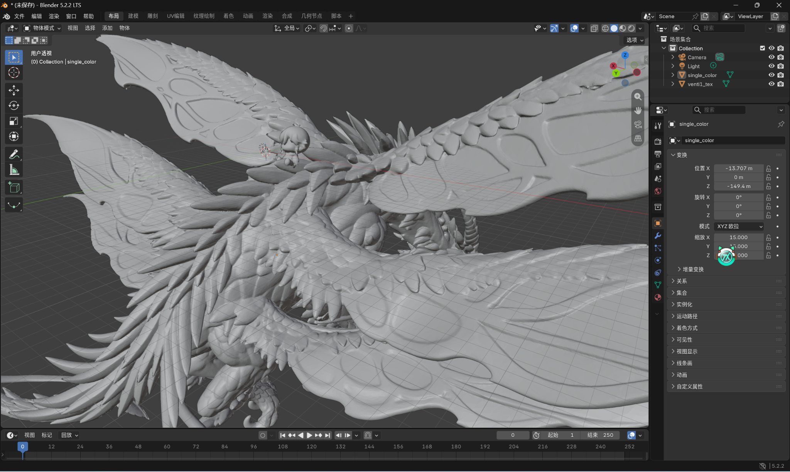
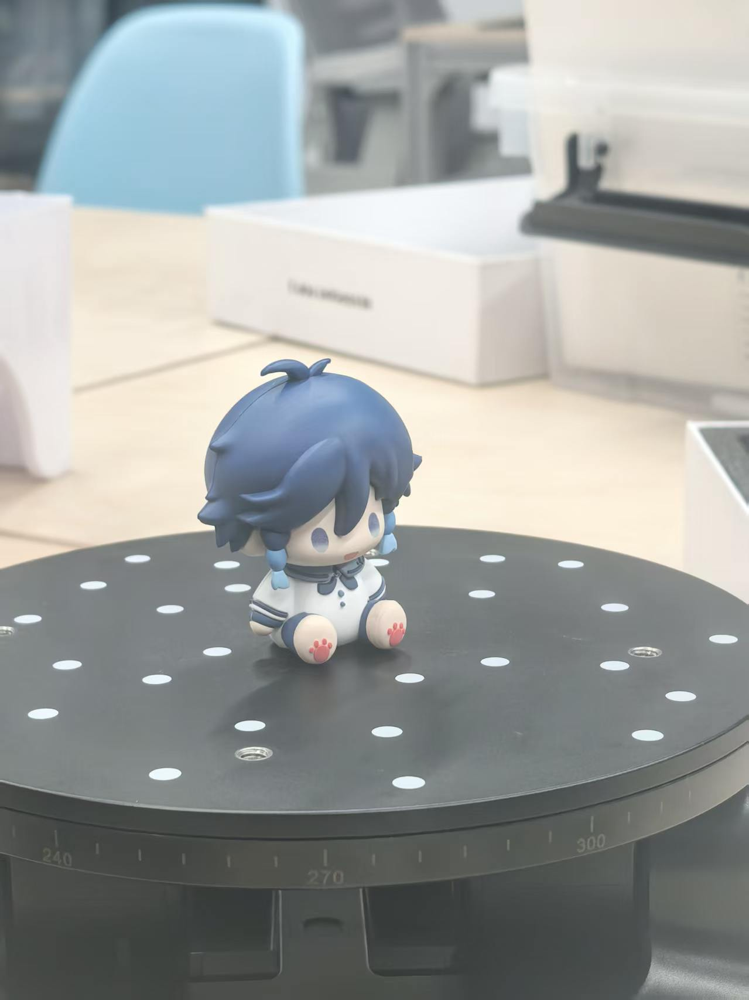
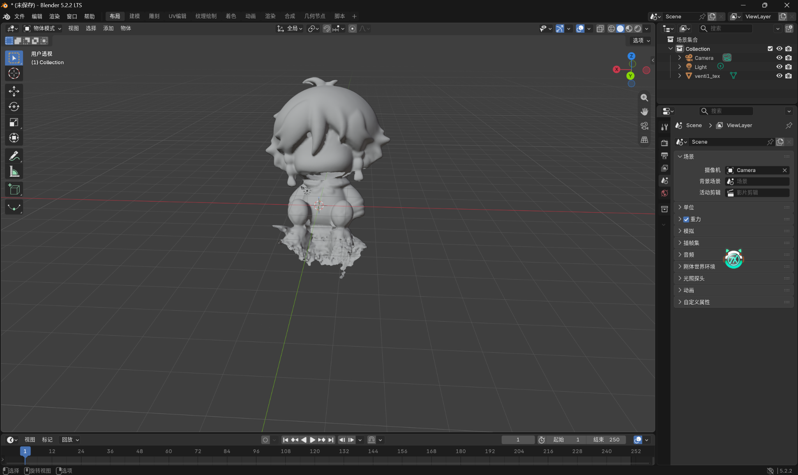
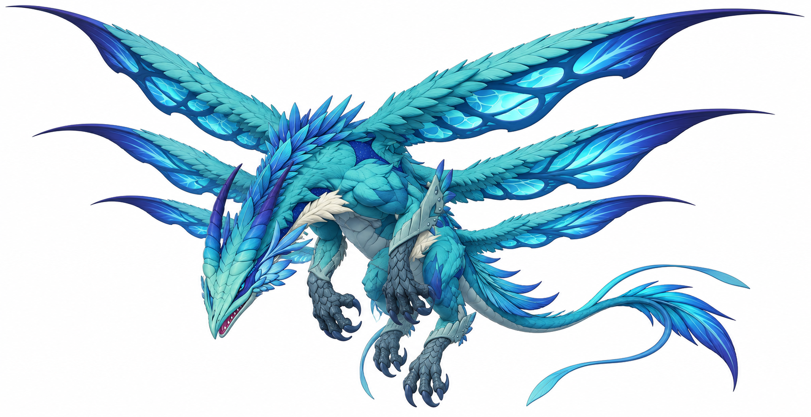

# 人偶骑龙｜从实物扫描到六翼龙场景

[Read in English ↓](#english-dragon)

2026 年 11 月 13 日 · 数字设计与制作过程记录

## 1. What Is It?｜这是什么作品？

我们把桌上的蓝发坐姿人偶做成了六翼龙的骑手。人偶模型来自实物扫描，保留了原来的头发、辫子和双脚向前伸出的坐姿。龙来自一张二维插画。我们先用 AI 补全被裁掉的翅膀，再生成龙的三维模型，最后在 Blender 里把两者放进同一个场景。

## 2. What Does It Do?｜它可以用来做什么？

这是一件可以在 Blender 中从不同角度观看的静态组合作品。原来坐在平面上的人偶，现在坐在龙颈后方，观众可以从翅膀之间看到小骑手。两个模型在场景中各自独立，便于调整骑手的位置或改变龙与人偶的大小关系。此次完成到场景摆放阶段。

## 3. How Was It Made?｜我们是怎么做的？

| 环节 | 实际使用的材料、设备和设置 |
| --- | --- |
| 实物采集 | 蓝发坐姿人偶 1 个、带白色圆点的黑色转台 1 台、Revopoint 扫描仪 1 台、桌面三脚架及笔记本电脑。软件为 Revo Scan 5.5.5 |
| 采集路线 | 扫描仪固定，人偶随转台旋转。调整后从背面起扫，连续旋转一周，回到背面结束 |
| 人偶修整 | Blender 5.2.2 LTS，导入 OBJ，使用 Bisect 清理底部，使用 F 填面 |
| 龙的建模 | ChatGPT 生成白底全身参考图，MakerWorld 的 Meshy 7.1 4K 生成三维模型，导出 STL |
| 场景摆放 | 在 Blender 中导入龙，调整两个对象的相对大小和位置。最终截图里龙的缩放值为 15，这个数值取决于导入文件的尺度 |

**① 采集实物。** 我们把人偶放在转台上，用三脚架固定扫描仪，在电脑上同时查看相机画面和逐渐形成的模型。第一次尝试遇到了重影。后来将人偶背面朝向扫描仪开始采集，让脸部在一段连续的扫描中经过镜头，回到背面就结束。在 Revo Scan 中完成一键处理后，我们得到彩色预览，并导出 OBJ 供后续编辑。

[实物近照](figurine.jpg) · [采集画面](cloud.jpg) · [现场短视频](turntable.mp4) · [软件处理录像节选，原录像约 06:18–07:31](processing.mp4)

**② 修整人偶。** 导入 Blender 后，屁股和脚下方连着一团杂面，下巴和头部还有缺口。我们先用切分工具移除底部杂面，再补头部小孔。下巴的边缘比较曲折，最后选择了直接选中边界、按 F 填面的做法，保留这个版本用于组合。

[下巴缺口近景](chin.png) · [填面后的正面效果](repaired.png)

**③ 从插画得到建模参考图。** 原图上方的一对龙翼超出了画面。我们在提示词中指定三对、共六片龙翼，要求补全翼尖，让四肢与尾部错开，并保留青蓝色翼面与靛蓝色翼缘。采用白底和前侧四分之三视角后，一张图里就能看清各部分的轮廓。

[原始插画](dragon-source.jpg) · [完整生图提示词](dragon-prompt.md)

**④ 生成龙并摆放骑手。** 我们把上面的参考图上传到 MakerWorld 的“图片生成 3D 模型”，选择 Meshy，下载生成的单色文件 `single_color.stl`。在 Blender 中把龙放大，让人偶坐到靠近龙颈的背部。最终场景中，人偶对象名为 `venti1_tex`，龙对象名为 `single_color`。

## 4. How Can Someone Reproduce It?｜怎样复现？

1. **准备采集。** 将坐姿人偶放在转台上，把扫描仪固定在三脚架上。观察 Revo Scan 的相机预览，确认头顶和双脚都在采集范围内。
2. **完成单圈扫描。** 从人偶背面开始，让转台连续经过一侧、正面和另一侧，回到背面后结束。通过预览检查面部轮廓，完成处理并导出 OBJ。
3. **修整扫描网格。** 将 OBJ 导入 Blender。在编辑模式使用 Bisect 切去脚下多余区域，从侧面检查切线高度。逐个选中孔洞边界，用 F 填面，转动模型查看下巴和头部。
4. **生成或复用参考图。** 想复现生图过程，可以将原始插画和完整提示词一起提交给图像工具。想从同一张输入图开始建模，可以直接使用本目录中的白底六翼龙参考图。
5. **生成龙模型。** 将参考图上传至 MakerWorld 的图片生成 3D 模型页面，使用 Meshy 生成并检查翼尖、四肢和尾尖，再导出 STL。
6. **组装场景。** 在人偶所在的 Blender 文件中导入 STL。用 S 调整比例，G 移动，R 旋转，使人偶朝向龙头。分别从侧面和上方检查坐面是否贴近龙背、背刺是否穿过身体。保存为 .blend，以便下次继续调整。

本次提交包含现场照片、软件录像节选、六翼龙参考图和完整提示词。可按以上步骤复现制作流程。

## 5. What Did You Learn?｜这次学到了什么？

最影响人偶效果的一次调整，是把扫描起点挪到背面。第一次遇到重影时，我们最在意的是脸部，因为面部轮廓稍有错位，从正面看就很明显。后来我们只让转台转一周，把扫描的起点和终点都放在相对能容忍误差的背面。这样，脸部在一段连续的采集中完成，得到的模型也足以继续修整。这个做法解决了我们当时的操作问题，重影的具体成因仍未确定。

扫描完成后，下巴的缺口和底部多出的杂面还需要分别处理。切掉底部能很快恢复坐姿轮廓，下巴直接填面则只能封住缺口。下次扫描时，我们会在撤掉设备前转动预览，专门检查下巴、发梢下方和坐面，再决定是否需要换角度补扫。

制作六翼龙时，我们发现原图里被裁掉的翼尖必须先补全，才能明确告诉图生 3D 工具每片翅膀延伸到哪里。最终摆放时，龙背的尖刺和翼根又限制了骑手的位置。下次会额外保存一张侧面接触图，和全景一起展示骑手是怎样坐稳的。若要制作可打印版本，还需检查模型封闭性、薄翼厚度和连接处。

---

## English · A Scanned Figurine Rides a Six-Winged Dragon

13 November 2026 · Digital design and fabrication log

### 1. What is it?

We turned a little blue-haired figurine on our desk into a dragon rider. Scanning the figurine captured its hair, braids and seated pose, with both feet stretched out in front. The dragon started as a 2D illustration. We used AI to complete the cropped wings, generated a 3D model from the finished image, and brought the two models together in Blender.

### 2. What does it do?

This is a static scene you can orbit in Blender. The figurine originally sat on a flat surface. Now it sits just behind the dragon’s neck, and you can catch a glimpse of the little rider between the wings. We kept the two objects separate so we could move the rider or adjust their relative sizes. We took this version through the scene layout stage.

### 3. How did we make it?

| Stage | What we used or did |
| --- | --- |
| Scan setup | One seated blue-haired figurine, a black turntable with white dots, a Revopoint scanner, a tabletop tripod and a laptop running Revo Scan 5.5.5 |
| Scan path | We kept the scanner still and rotated the figurine. On the revised pass, we started at the back and stopped when the turntable had made one full revolution. |
| Mesh cleanup | Blender 5.2.2 LTS. We imported the OBJ, trimmed the underside with Bisect and used F to fill holes. |
| Dragon model | We used ChatGPT for the full-body reference on a white background, then Meshy 7.1 4K in MakerWorld to generate the model and export an STL. |
| Scene layout | We imported the dragon into Blender and adjusted the size and position of each object. The dragon’s scale was 15 in the final screenshot. That value depends on the scale of the imported files. |

**Scanning the figurine.** We placed it on the turntable, mounted the scanner on the tripod and watched both the camera feed and the growing model on the laptop. Our first scan showed doubled outlines. For the next pass we started at the back, let the face pass the camera in one continuous sweep, and stopped when the back came into view again. Revo Scan’s one-click processing gave us a colour preview. We exported an OBJ for cleanup.

[Figurine close-up](figurine.jpg) · [Scan in progress](cloud.jpg) · [Turntable video](turntable.mp4) · [Processing clip, approximately 06:18–07:31 in the original recording](processing.mp4)

**Cleaning up the scan.** A tangle of extra mesh clung to the underside of the seat and feet. We also found gaps around the chin and head. We cut away the extra mesh first, then closed the small holes in the head. The chin had an uneven border. We selected its boundary, pressed F to fill it and used that version for the scene.

[Gap under the chin](chin.png) · [Front view after filling the hole](repaired.png)

**Preparing the dragon reference.** The top pair of wings ran off the edge of the original illustration. In the prompt we specified three pairs of wings, asked for every wingtip to fit in the frame, and kept the legs and tail clear of each other. We also specified blue-green wing membranes with indigo edges. A front three-quarter view against white made each silhouette readable in a single image.

[Original illustration](dragon-source.jpg) · [Full image-generation prompt](dragon-prompt.md)

**Placing the rider.** We uploaded the reference to MakerWorld’s image-to-3D tool, chose Meshy and downloaded the single-colour model as `single_color.stl`. In Blender we scaled up the dragon and seated the figurine on its back, close to the neck. The final scene contains the rider object `venti1_tex` and the dragon object `single_color`.

### 4. How can someone reproduce it?

1. Set the figurine on the turntable and mount the scanner on the tripod. Check the Revo Scan camera preview to make sure both feet and the top of the head are in frame.
2. Start at the figurine’s back. Rotate past one side, the face and the other side in one continuous pass. Stop at the back, inspect the facial outline, process the scan and export an OBJ.
3. Import the OBJ into Blender. In Edit Mode, use Bisect to trim the extra mesh beneath the feet. Check the cut height from the side. Select each hole boundary and press F to fill it, then rotate the model to inspect the chin and head.
4. To recreate the reference, give the image tool the original illustration and the full prompt linked above. To start the modelling stage with our exact input, use the white-background dragon reference.
5. Upload that image to MakerWorld, generate the dragon with Meshy, and inspect the wingtips, limbs and tail tip before exporting the STL.
6. Import the STL into the figurine’s Blender scene. Use S to scale, G to move and R to rotate the rider so it faces the dragon’s head. Check from the side and above that the seat meets the back and that the spines clear the rider. Save the scene as a .blend file for later adjustments.

The project includes setup photos, a software recording excerpt, the six-winged dragon reference and the complete prompt.

### 5. What did we learn?

Moving the start of the scan to the back made the biggest difference to the figurine. Even a small mismatch in the face was obvious from the front. Keeping the scan to a single turn let us capture the face in one pass and put the start and end at the more forgiving back of the head. That gave us a mesh we could work with. We never pinned down the exact cause of the doubled outlines.

Trimming the underside quickly recovered the seated silhouette. Filling the hole under the chin closed the gap, but the missing surface detail was still missing. Next time we’ll rotate the preview while the scanner is still set up, inspect the chin, the areas under the hair tips and the seat, and decide whether to capture another angle.

Completing the cropped wingtips in the reference gave the image-to-3D tool a clear endpoint for each wing. Once the dragon was in Blender, its back spines and wing roots limited where the rider could sit. Next time we’ll save a close side view of the seat alongside the wide shot to show how the two surfaces meet. A printable version would also need checks for mesh closure, wing thickness and the joints.
