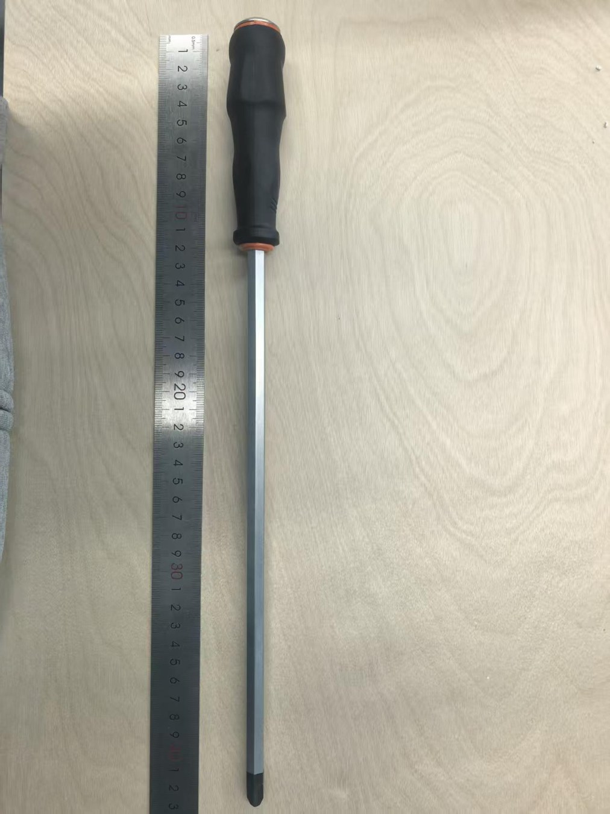
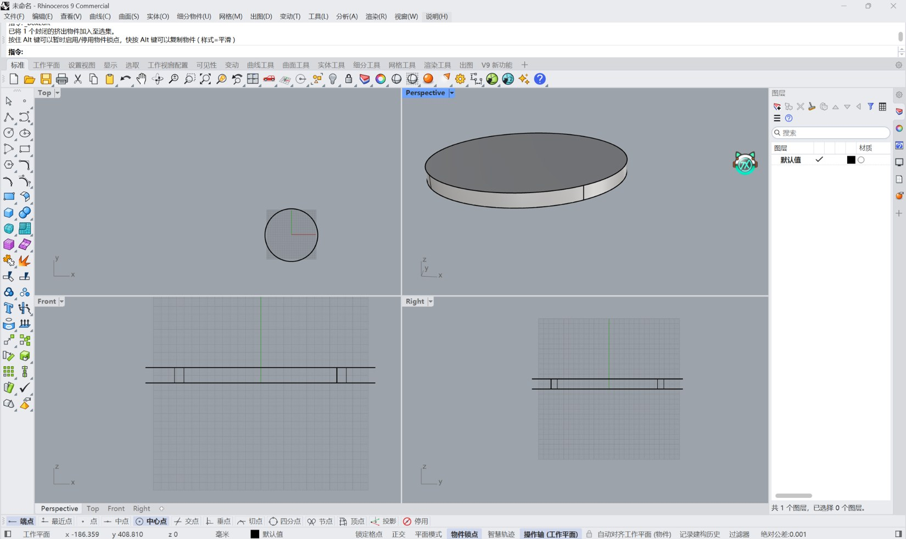
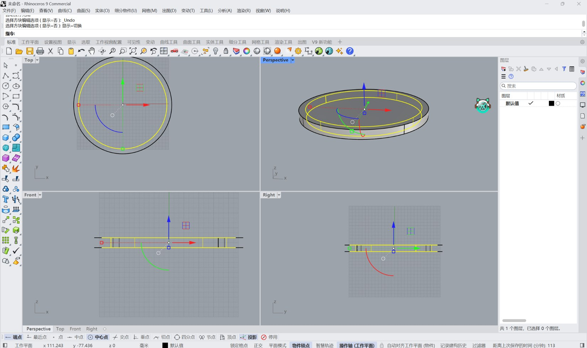
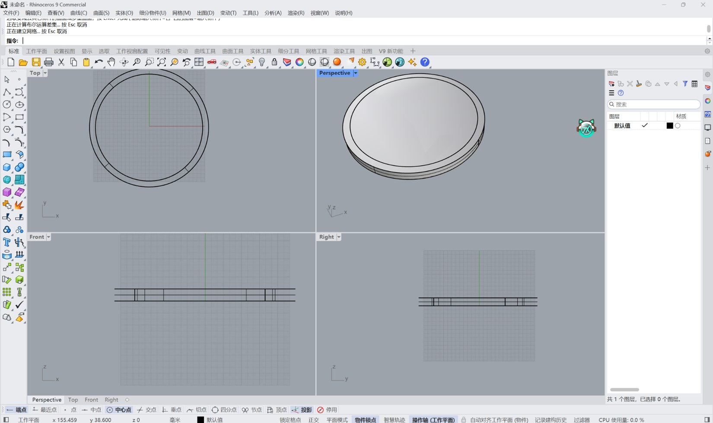
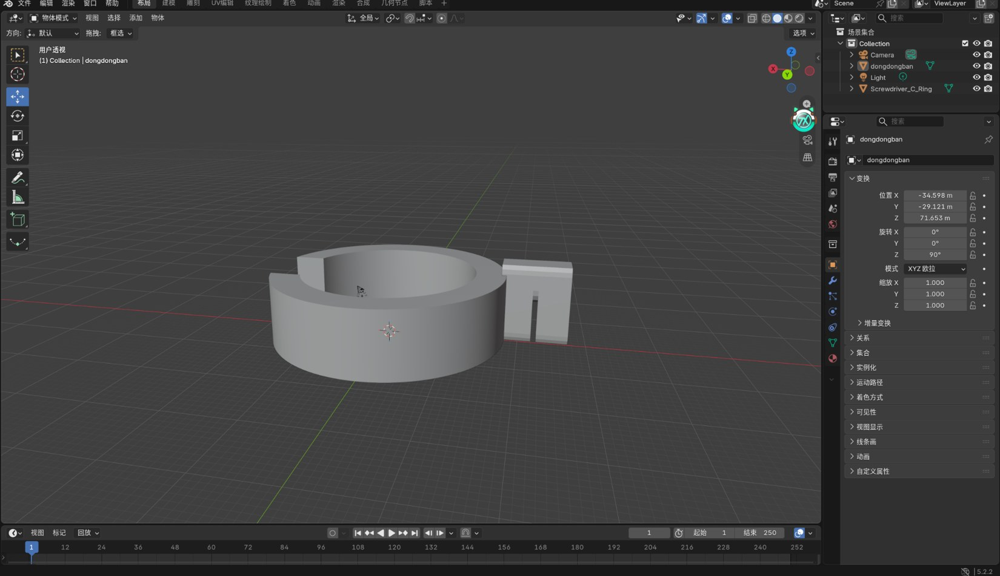
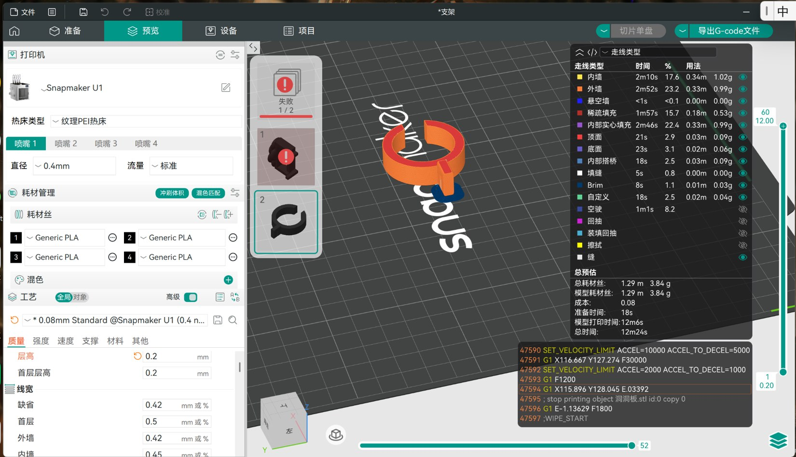
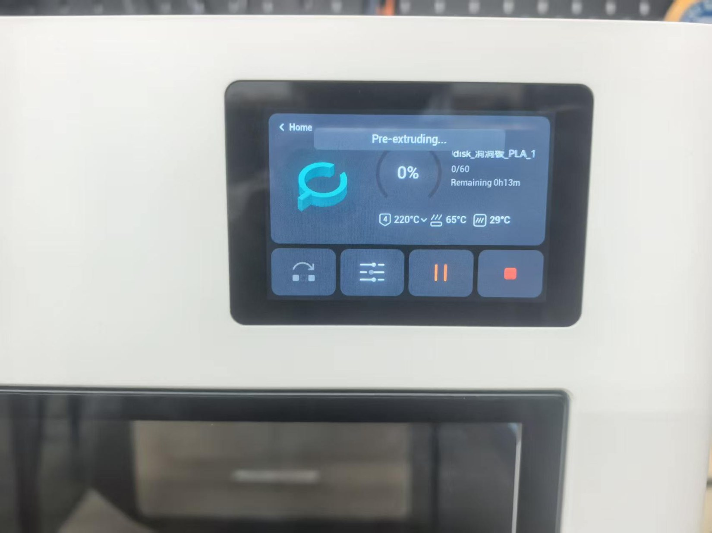
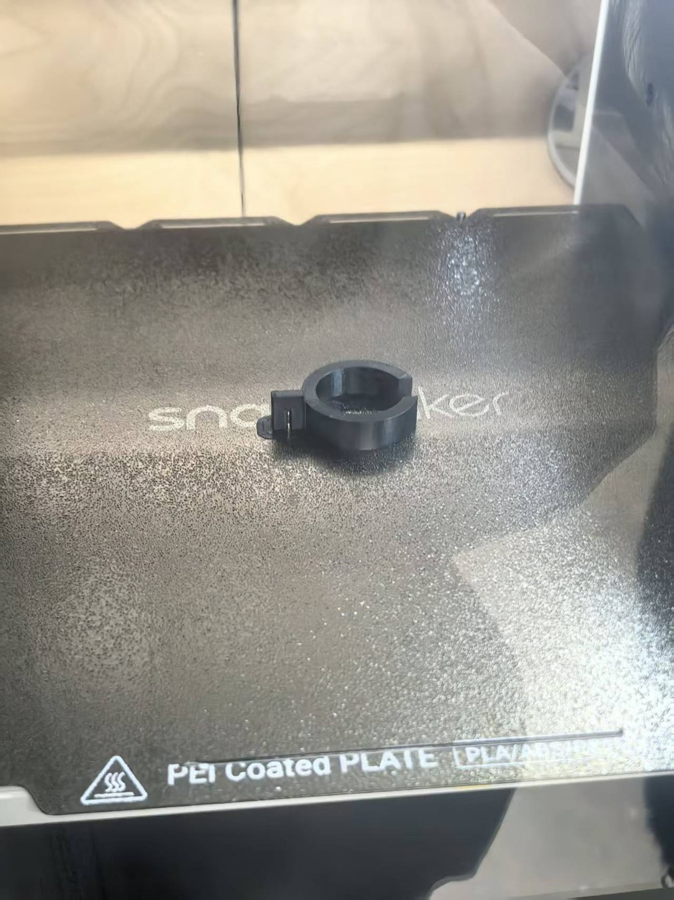
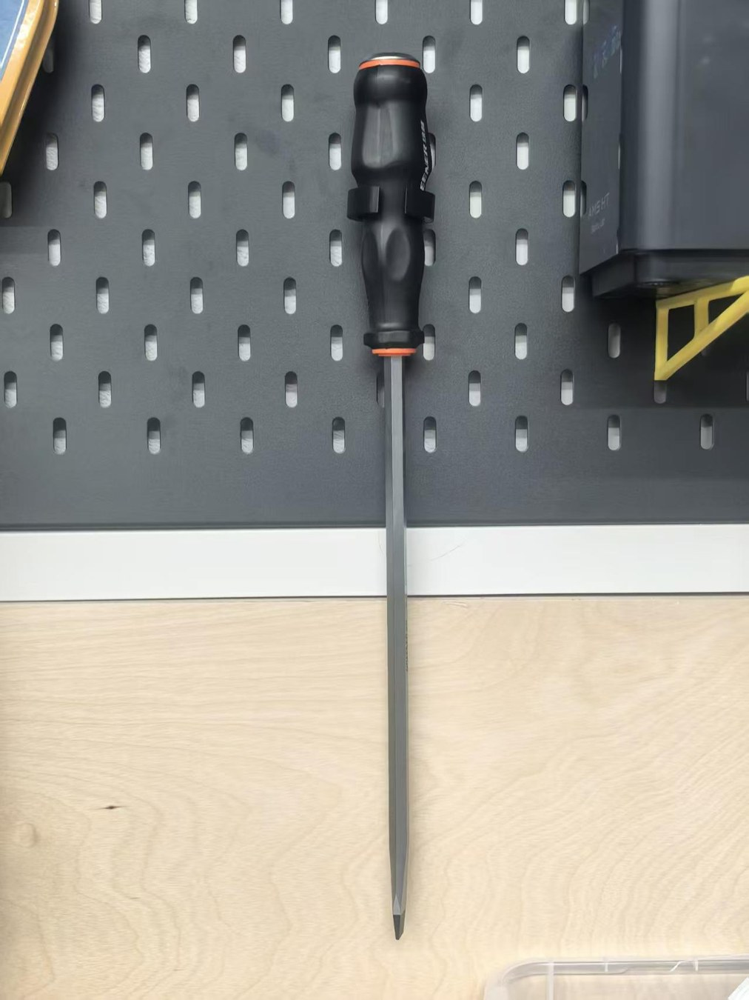

# 给长螺丝刀做一个洞洞板挂架

这把螺丝刀的金属杆很长，我想给它在洞洞板上找个固定的位置。老师提供了能卡进板孔的连接件，有 STP 和 STL 两种格式。我沿用这个连接件，自己设计了前面托住手柄的部分。最后打出来的是一个带卡扣的 C 形托环，整件打印花了大约 13 分钟。

## 先想清楚怎么拿，再决定怎么挂

最先考虑过横放。这么长的一把螺丝刀，横着摆，我会想在两处各做一个支撑。换成竖着挂，一个托环就能借助手柄粗细的变化把它托住，刀杆自然垂下来。

一开始想到的是完整的圆环。问题出在取用上：刀杆有多长，往上抽的时候就得给它留出差不多那么高的空间。所以我在朝外的一侧留了一个小口。放的时候，先把较细的金属杆从侧面送进去，再放低手柄，让较粗的位置落在环上。取的时候反过来，抬到刀杆对准开口，就能横向移出来。

## 在 Rhino 里试做圆环

我先拉出一个矮圆柱作为外形，再在里面建一个小圆柱。调小圆柱尺寸时，两个圆心一度错开，我就回到俯视图检查内外圈的间距。下面两张图分别记录了圆柱底坯和调整内圆柱的过程。

接着尝试用布尔差集挖出中孔。做完后俯视图出现了两圈线，但透视图的中心看起来仍然有一层面。当时没能从这个画面确认中间是否已经挖通。后来我把尺寸和开口的量法写清楚，交给 ChatGPT 生成独立的托环 STL，后面在 Blender 里用的就是这个文件。

| 托环部位 | 最终建模尺寸 |
| --- | --- |
| 内半径 / 内径 | 13.5 mm / 27 mm |
| 外半径 / 外径 | 18 mm / 36 mm |
| 环壁厚度 | 4.5 mm |
| 托环高度 | 10 mm |
| 侧面开口 | 净宽 10 mm，贯穿整个高度 |

这里的 **10 mm** 是从开口左端到右端直接量的距离。沿内圈量是 10 mm，沿外圈量也是 10 mm，所以开口的两个切面互相平行。托环模型可以单独下载，配套的洞洞板卡扣使用老师提供的文件。[下载 C 形托环 STL](Screwdriver_C_Ring.stl)

## 在 Blender 里拼合两个部件

我把托环 STL 和老师的连接件导入 Blender，把卡扣移到圆环外侧，给开口前方留出刀杆进出的空间。摆放时我特意把两个部件的底面对齐。这样送去打印时，圆环可以平放在热床上，连接件底部也能接触热床，第一层能铺开的面积更大。

## 切片，拷到 U 盘，上机打印

把拼好的模型导入 Snapmaker 的切片软件后，我在预览里看到了整圈的走线，开口两端也清楚地分开了。下图选中的是第 2 盘，右边是这一盘的耗材和时间估算。

| 本次切片设置与估算 | 数值 |
| --- | --- |
| 打印机 / 热床 | Snapmaker U1 / 纹理 PEI 热床 |
| 耗材配置 / 喷嘴直径 | Generic PLA / 0.4 mm |
| 层高 / 首层层高 | 0.2 mm / 0.2 mm |
| 预计耗材 | 1.29 m，约 3.84 g |
| 预计用时 | 准备 18 秒，模型打印 12 分 6 秒，合计 12 分 24 秒 |

我导出 G-code，拷到 U 盘，再把 U 盘插到打印机上启动任务。拍下屏幕时，机器刚开始预挤出，进度是 0/60 层，屏幕提示还剩 13 分钟。实际也是大约 13 分钟就打完了。

## 装到板上，试一下这把螺丝刀

我把卡扣装上洞洞板，让开口朝外，再把螺丝刀放进去。实际挂上后，托环落在手柄由细变粗的位置，金属杆垂在下方。这一版和手里这把螺丝刀配合得很合适。对我来说，留这个小口最有用的地方就是拿工具时能往前取，省去了把整根长杆往上抽的动作。

