<!-- 首页由章节文件自动生成，请编辑对应章节。 -->

# 数字设计与制作手记

## 目录

- [第 1 章 · 人偶骑龙｜从实物扫描到六翼龙场景](#chapter-01)
- [第 2 章 · 给长螺丝刀做一个洞洞板挂架](#chapter-02)

---

## 第 1 章 · 人偶骑龙｜从实物扫描到六翼龙场景

2026 年 11 月 13 日 · 数字设计与制作过程记录

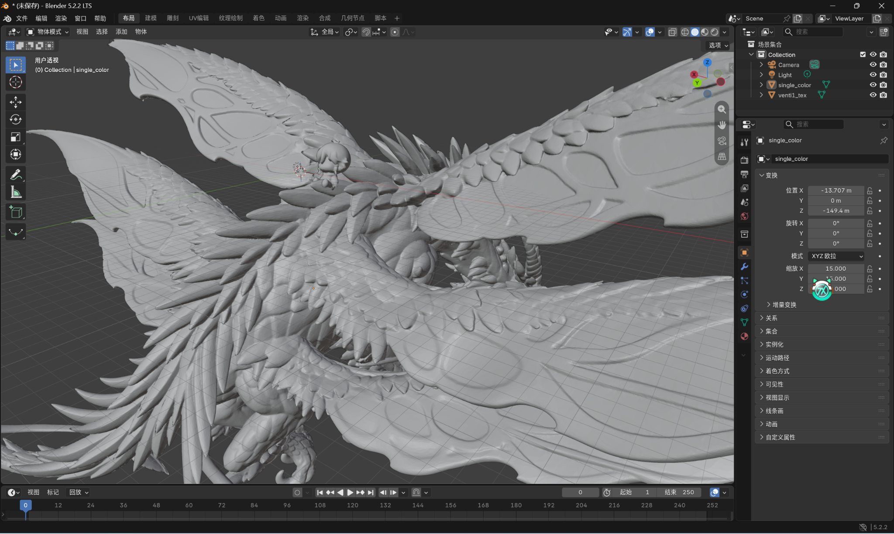

### 1. What Is It?｜这是什么作品？

我们把桌上的蓝发坐姿人偶做成了六翼龙的骑手。人偶模型来自实物扫描，保留了原来的头发、辫子和双脚向前伸出的坐姿。龙来自一张二维插画。我们先用 AI 补全被裁掉的翅膀，再生成龙的三维模型，最后在 Blender 里把两者放进同一个场景。

### 2. What Does It Do?｜它可以用来做什么？

这是一件可以在 Blender 中从不同角度观看的静态组合作品。原来坐在平面上的人偶，现在坐在龙颈后方，观众可以从翅膀之间看到小骑手。两个模型在场景中各自独立，便于调整骑手的位置或改变龙与人偶的大小关系。此次完成到场景摆放阶段。

### 3. How Was It Made?｜我们是怎么做的？

| 环节 | 实际使用的材料、设备和设置 |
| --- | --- |
| 实物采集 | 蓝发坐姿人偶 1 个、带白色圆点的黑色转台 1 台、Revopoint 扫描仪 1 台、桌面三脚架及笔记本电脑。软件为 Revo Scan 5.5.5 |
| 采集路线 | 扫描仪固定，人偶随转台旋转。调整后从背面起扫，连续旋转一周，回到背面结束 |
| 人偶修整 | Blender 5.2.2 LTS，导入 OBJ，使用 Bisect 清理底部，使用 F 填面 |
| 龙的建模 | ChatGPT 生成白底全身参考图，MakerWorld 的 Meshy 7.1 4K 生成三维模型，导出 STL |
| 场景摆放 | 在 Blender 中导入龙，调整两个对象的相对大小和位置。最终截图里龙的缩放值为 15，这个数值取决于导入文件的尺度 |

**① 采集实物。** 我们把人偶放在转台上，用三脚架固定扫描仪，在电脑上同时查看相机画面和逐渐形成的模型。第一次尝试遇到了重影。后来将人偶背面朝向扫描仪开始采集，让脸部在一段连续的扫描中经过镜头，回到背面就结束。在 Revo Scan 中完成一键处理后，我们得到彩色预览，并导出 OBJ 供后续编辑。

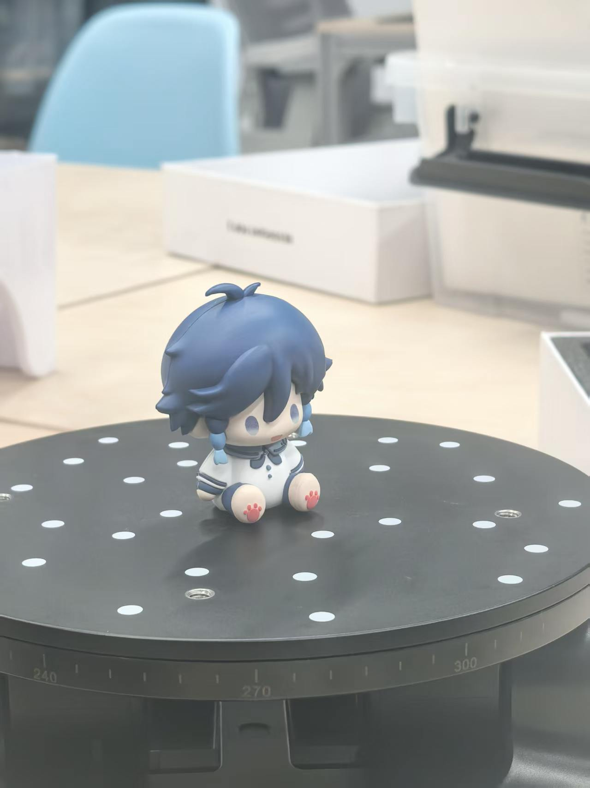

[实物近照](figurine.jpg) · [采集画面](cloud.jpg) · [现场短视频](turntable.mp4) · [软件处理录像节选，原录像约 06:18–07:31](processing.mp4)

**② 修整人偶。** 导入 Blender 后，屁股和脚下方连着一团杂面，下巴和头部还有缺口。我们先用切分工具移除底部杂面，再补头部小孔。下巴的边缘比较曲折，最后选择了直接选中边界、按 F 填面的做法，保留这个版本用于组合。

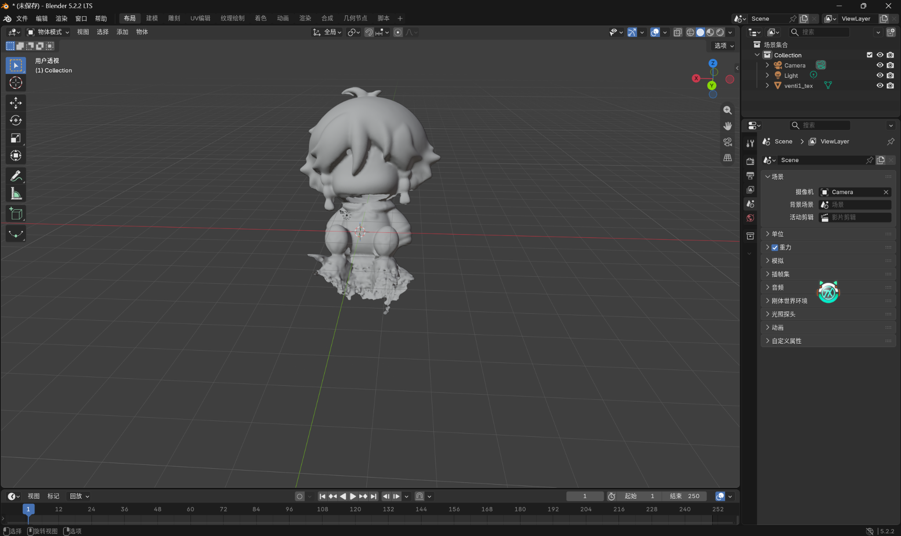

[下巴缺口近景](chin.png) · [填面后的正面效果](repaired.png)

**③ 从插画得到建模参考图。** 原图上方的一对龙翼超出了画面。我们在提示词中指定三对、共六片龙翼，要求补全翼尖，让四肢与尾部错开，并保留青蓝色翼面与靛蓝色翼缘。采用白底和前侧四分之三视角后，一张图里就能看清各部分的轮廓。

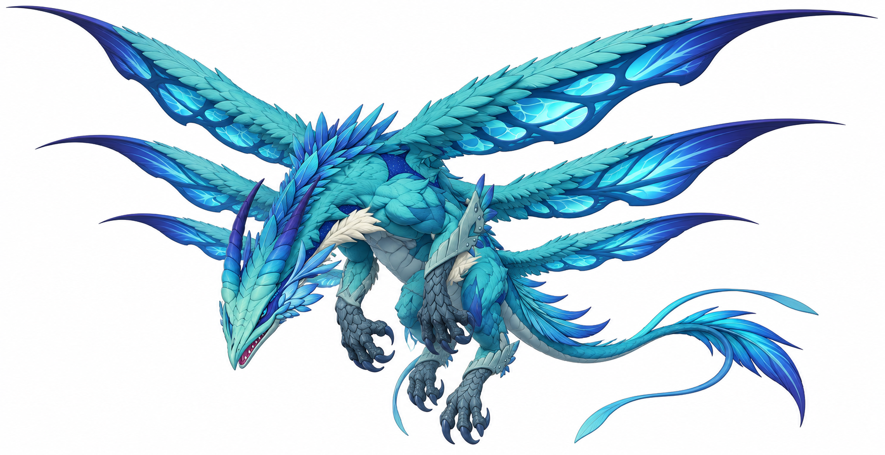

[原始插画](dragon-source.jpg) · [完整生图提示词](dragon-prompt.md)

**④ 生成龙并摆放骑手。** 我们把上面的参考图上传到 MakerWorld 的“图片生成 3D 模型”，选择 Meshy，下载生成的单色文件 `single_color.stl`。在 Blender 中把龙放大，让人偶坐到靠近龙颈的背部。最终场景中，人偶对象名为 `venti1_tex`，龙对象名为 `single_color`。

### 4. How Can Someone Reproduce It?｜怎样复现？

1. **准备采集。** 将坐姿人偶放在转台上，把扫描仪固定在三脚架上。观察 Revo Scan 的相机预览，确认头顶和双脚都在采集范围内。
2. **完成单圈扫描。** 从人偶背面开始，让转台连续经过一侧、正面和另一侧，回到背面后结束。通过预览检查面部轮廓，完成处理并导出 OBJ。
3. **修整扫描网格。** 将 OBJ 导入 Blender。在编辑模式使用 Bisect 切去脚下多余区域，从侧面检查切线高度。逐个选中孔洞边界，用 F 填面，转动模型查看下巴和头部。
4. **生成或复用参考图。** 想复现生图过程，可以将原始插画和完整提示词一起提交给图像工具。想从同一张输入图开始建模，可以直接使用本目录中的白底六翼龙参考图。
5. **生成龙模型。** 将参考图上传至 MakerWorld 的图片生成 3D 模型页面，使用 Meshy 生成并检查翼尖、四肢和尾尖，再导出 STL。
6. **组装场景。** 在人偶所在的 Blender 文件中导入 STL。用 S 调整比例，G 移动，R 旋转，使人偶朝向龙头。分别从侧面和上方检查坐面是否贴近龙背、背刺是否穿过身体。保存为 .blend，以便下次继续调整。

本次提交包含现场照片、软件录像节选、六翼龙参考图和完整提示词。可按以上步骤复现制作流程。

### 5. What Did You Learn?｜这次学到了什么？

最影响人偶效果的一次调整，是把扫描起点挪到背面。第一次遇到重影时，我们最在意的是脸部，因为面部轮廓稍有错位，从正面看就很明显。后来我们只让转台转一周，把扫描的起点和终点都放在相对能容忍误差的背面。这样，脸部在一段连续的采集中完成，得到的模型也足以继续修整。这个做法解决了我们当时的操作问题，重影的具体成因仍未确定。

扫描完成后，下巴的缺口和底部多出的杂面还需要分别处理。切掉底部能很快恢复坐姿轮廓，下巴直接填面则只能封住缺口。下次扫描时，我们会在撤掉设备前转动预览，专门检查下巴、发梢下方和坐面，再决定是否需要换角度补扫。

制作六翼龙时，我们发现原图里被裁掉的翼尖必须先补全，才能明确告诉图生 3D 工具每片翅膀延伸到哪里。最终摆放时，龙背的尖刺和翼根又限制了骑手的位置。下次会额外保存一张侧面接触图，和全景一起展示骑手是怎样坐稳的。若要制作可打印版本，还需检查模型封闭性、薄翼厚度和连接处。

---

## 第 2 章 · 给长螺丝刀做一个洞洞板挂架

这把螺丝刀的金属杆很长，我想给它在洞洞板上找个固定的位置。老师提供了能卡进板孔的连接件，有 STP 和 STL 两种格式。我沿用这个连接件，自己设计了前面托住手柄的部分。最后打出来的是一个带卡扣的 C 形托环，整件打印花了大约 13 分钟。

### 先想清楚怎么拿，再决定怎么挂

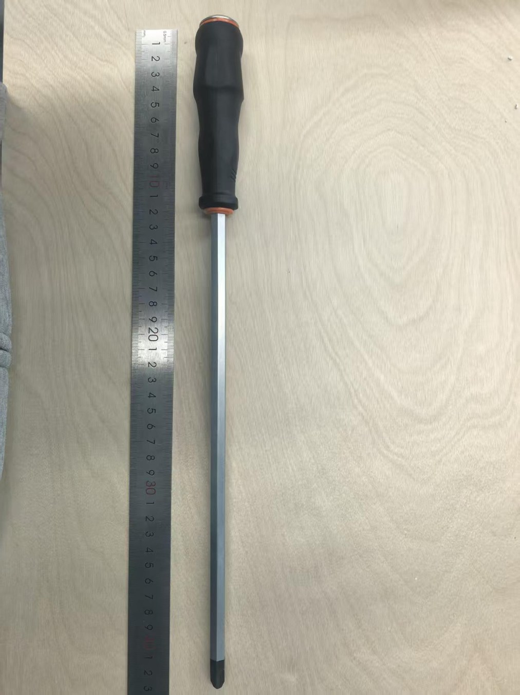

最先考虑过横放。这么长的一把螺丝刀，横着摆，我会想在两处各做一个支撑。换成竖着挂，一个托环就能借助手柄粗细的变化把它托住，刀杆自然垂下来。

一开始想到的是完整的圆环。问题出在取用上：刀杆有多长，往上抽的时候就得给它留出差不多那么高的空间。所以我在朝外的一侧留了一个小口。放的时候，先把较细的金属杆从侧面送进去，再放低手柄，让较粗的位置落在环上。取的时候反过来，抬到刀杆对准开口，就能横向移出来。

### 在 Rhino 里试做圆环

我先拉出一个矮圆柱作为外形，再在里面建一个小圆柱。调小圆柱尺寸时，两个圆心一度错开，我就回到俯视图检查内外圈的间距。下面两张图分别记录了圆柱底坯和调整内圆柱的过程。

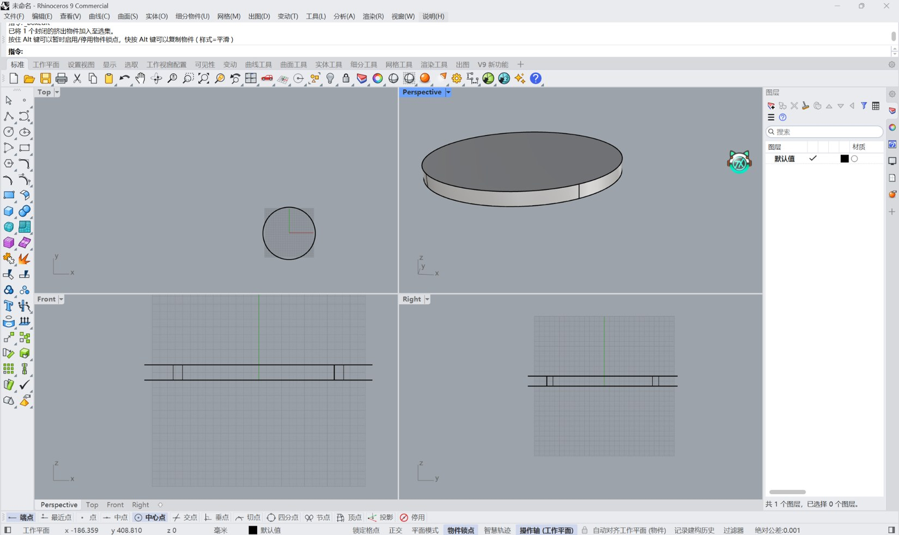

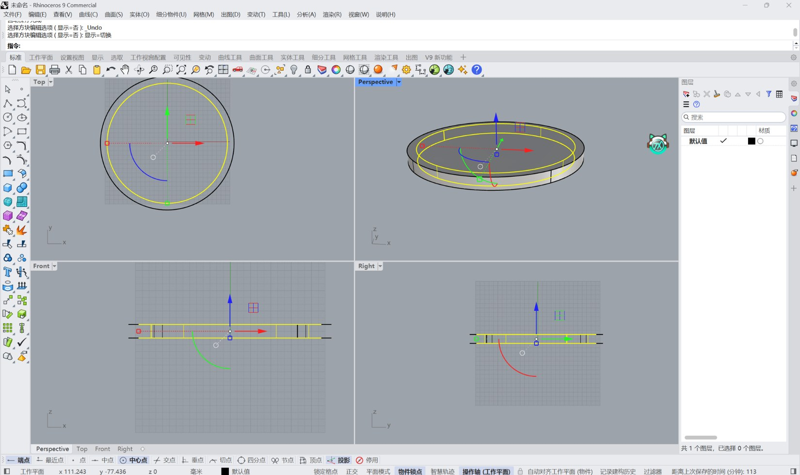

接着尝试用布尔差集挖出中孔。做完后俯视图出现了两圈线，但透视图的中心看起来仍然有一层面。当时没能从这个画面确认中间是否已经挖通。后来我把尺寸和开口的量法写清楚，交给 ChatGPT 生成独立的托环 STL，后面在 Blender 里用的就是这个文件。

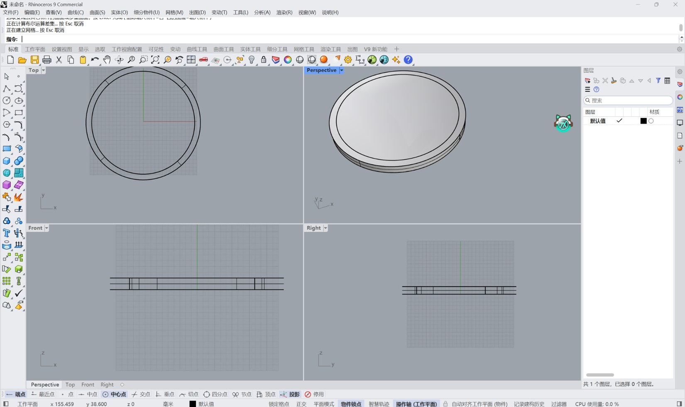

| 托环部位 | 最终建模尺寸 |
| --- | --- |
| 内半径 / 内径 | 13.5 mm / 27 mm |
| 外半径 / 外径 | 18 mm / 36 mm |
| 环壁厚度 | 4.5 mm |
| 托环高度 | 10 mm |
| 侧面开口 | 净宽 10 mm，贯穿整个高度 |

这里的 **10 mm** 是从开口左端到右端直接量的距离。沿内圈量是 10 mm，沿外圈量也是 10 mm，所以开口的两个切面互相平行。托环模型可以单独下载，配套的洞洞板卡扣使用老师提供的文件。[下载 C 形托环 STL](Screwdriver_C_Ring.stl)

### 在 Blender 里拼合两个部件

我把托环 STL 和老师的连接件导入 Blender，把卡扣移到圆环外侧，给开口前方留出刀杆进出的空间。摆放时我特意把两个部件的底面对齐。这样送去打印时，圆环可以平放在热床上，连接件底部也能接触热床，第一层能铺开的面积更大。

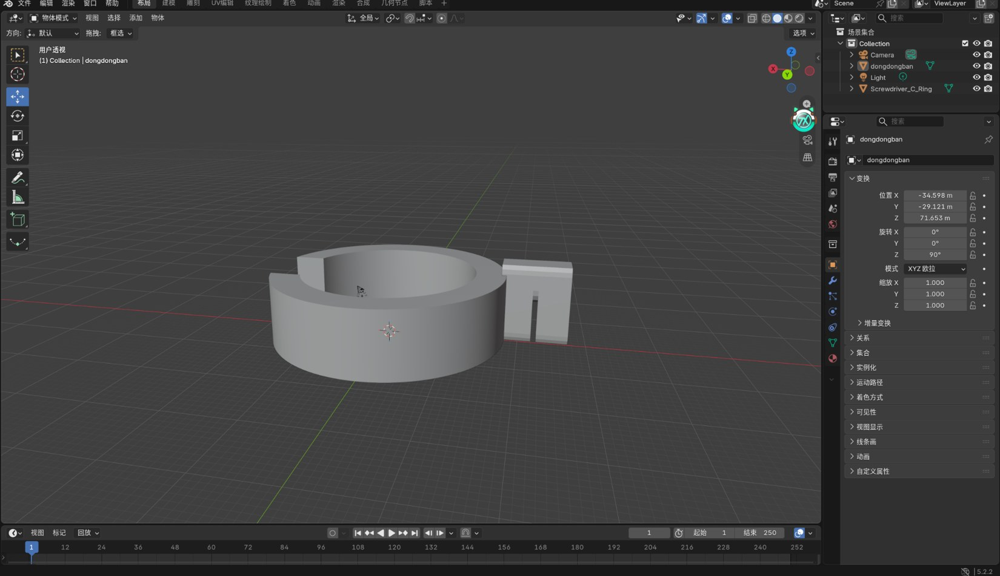

### 切片，拷到 U 盘，上机打印

把拼好的模型导入 Snapmaker 的切片软件后，我在预览里看到了整圈的走线，开口两端也清楚地分开了。下图选中的是第 2 盘，右边是这一盘的耗材和时间估算。

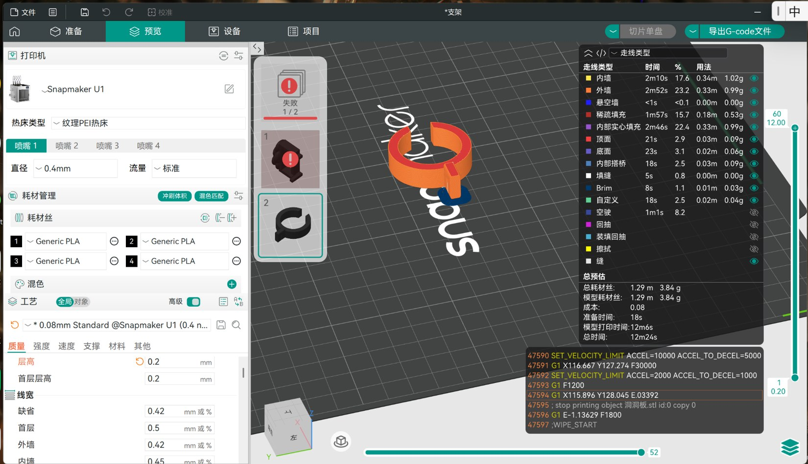

| 本次切片设置与估算 | 数值 |
| --- | --- |
| 打印机 / 热床 | Snapmaker U1 / 纹理 PEI 热床 |
| 耗材配置 / 喷嘴直径 | Generic PLA / 0.4 mm |
| 层高 / 首层层高 | 0.2 mm / 0.2 mm |
| 预计耗材 | 1.29 m，约 3.84 g |
| 预计用时 | 准备 18 秒，模型打印 12 分 6 秒，合计 12 分 24 秒 |

我导出 G-code，拷到 U 盘，再把 U 盘插到打印机上启动任务。拍下屏幕时，机器刚开始预挤出，进度是 0/60 层，屏幕提示还剩 13 分钟。实际也是大约 13 分钟就打完了。

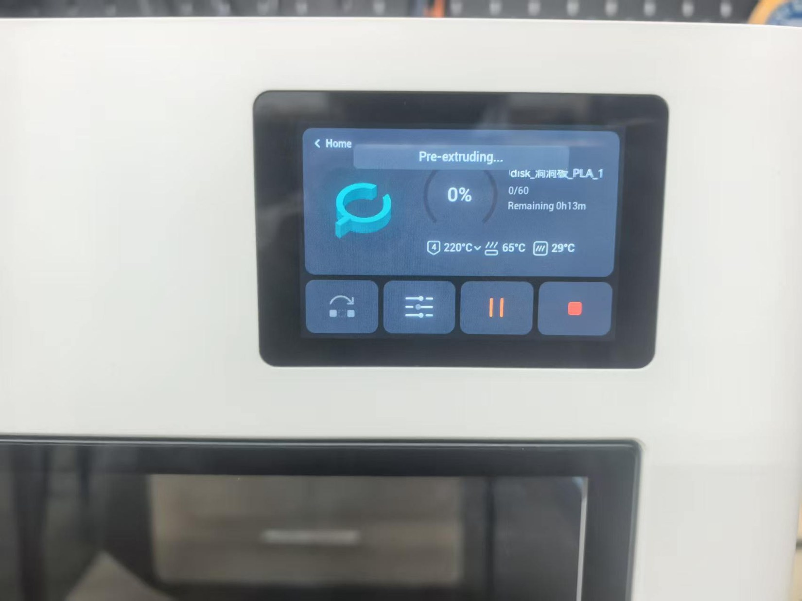

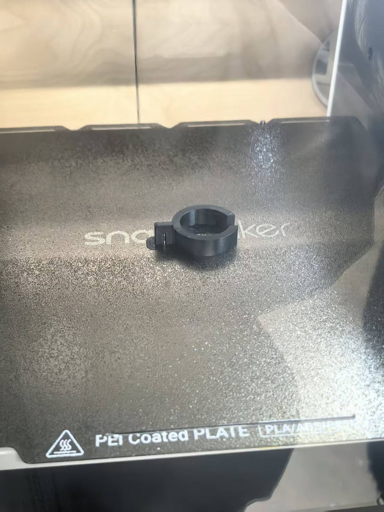

### 装到板上，试一下这把螺丝刀

我把卡扣装上洞洞板，让开口朝外，再把螺丝刀放进去。实际挂上后，托环落在手柄由细变粗的位置，金属杆垂在下方。这一版和手里这把螺丝刀配合得很合适。对我来说，留这个小口最有用的地方就是拿工具时能往前取，省去了把整根长杆往上抽的动作。

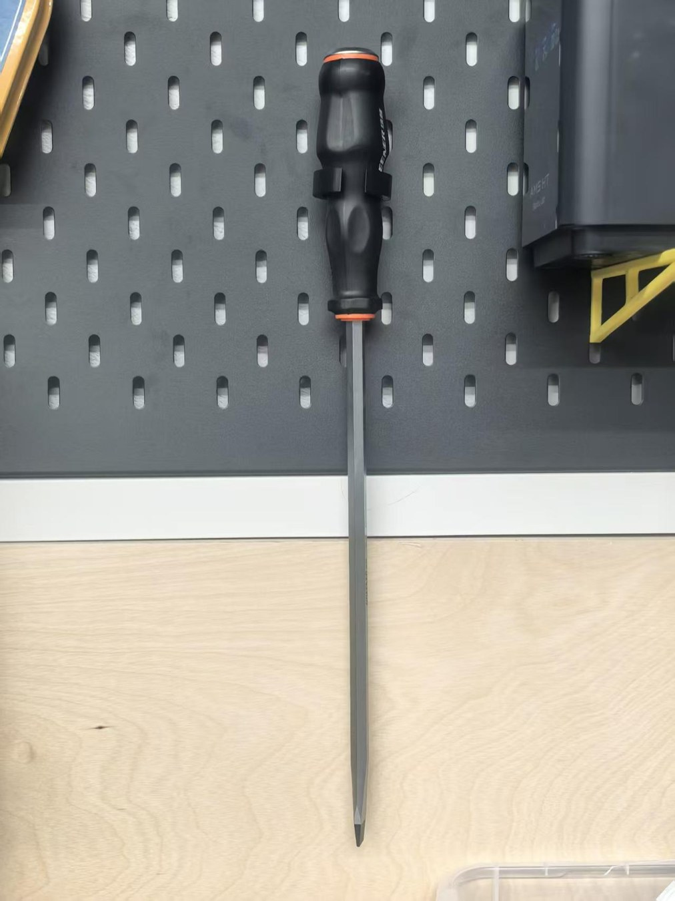
